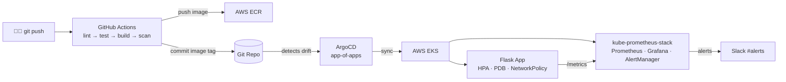

# GitOps DevOps Showcase

A production-grade platform demonstrating full-lifecycle DevOps: IaC, GitOps, CI/CD, and Observability — all from a single repository. One `git push` deploys the app with zero manual steps.

## Architecture



## Stack

| Layer | Technology |
|---|---|
| Cloud infra | AWS EKS, VPC, ECR, ALB |
| IaC | Terraform 1.10+ + community modules |
| GitOps | ArgoCD 2.x (app-of-apps pattern) |
| CI/CD | GitHub Actions (OIDC — no static AWS credentials) |
| App | Python 3.12, Flask 3, prometheus-client, Gunicorn |
| Observability | kube-prometheus-stack (Prometheus, Grafana, AlertManager) |
| Security | Trivy in CI, NetworkPolicy, non-root container, IRSA |

## Repository Layout

```
mayfly/
├── app/          Flask microservice + tests + Dockerfile
├── infra/        Terraform modules (vpc, eks, ecr, github-oidc) + dev environment
├── charts/       Helm charts: flask-app (7 resources) and monitoring
├── manifests/    ArgoCD Application CRDs (app-of-apps)
├── deploy/kind/  Local cluster: kind config, Argo CD values, kind app-of-apps
└── .github/      CI pipeline + Terraform plan workflow
```

## Run locally (kind)

No AWS account needed. The Makefile needs bash: on Linux and macOS any
shell will do; on Windows, run it from Git Bash, or from a WSL2 distro with
Docker Desktop's WSL integration enabled (clone into the Linux filesystem
rather than `/mnt/c`).

| Tool | Version | Needed for |
|---|---|---|
| Docker | running engine | `make demo` |
| [kind](https://kind.sigs.k8s.io/) | v0.33+ | `make demo` |
| kubectl | 1.34–1.36 (kind's node runs Kubernetes 1.35) | `make demo`, `make ui`, `make drift` |
| Helm | 3.x, not 4 | `make demo`, `make lint` |
| make, openssl | any (Git for Windows ships openssl) | everything |
| Python | 3.12, as in CI and the app image | `make lint` |
| gitleaks | 8.x | `make lint`, `make hooks` |
| Terraform | 1.10+ (CI pins 1.16.6) | `make lint` |
| tflint | any recent | `make lint` |
| trivy | optional | the image scan CI runs: `trivy image mayfly/flask-app:dev` |

On Windows, `winget` has all of them except Docker Desktop's engine. Two
traps there: Docker Desktop puts its own, older kubectl on the system PATH
ahead of any you install, and `python3` can be the Microsoft Store alias
rather than a real Python (the Makefile uses `py -3.12` on Windows for that
reason).

If `make demo` fails with `no cached repo found ... (try 'helm repo update')`,
a Helm repo you added earlier has no local index; `helm repo update` fixes it.

```bash
make demo      # kind cluster + Argo CD + app + kube-prometheus-stack
make ui        # port-forwards and prints logins: Argo CD :8080, Grafana :3000, app :8081
make destroy   # delete the cluster
```

Argo CD deploys from GitHub, not from your working copy, so local edits to
`charts/` are not picked up until pushed. To try a branch:
`git push -u origin <branch> && make demo REVISION=<branch>`. The app image
is the exception: it is built from `app/` locally and loaded into the node.

What differs from AWS lives in `deploy/kind/` and `charts/*/values-kind.yaml`:
no ingress (port-forward instead), no Slack receiver, and the control-plane
scrape targets kind cannot expose are switched off.

## Prerequisites (AWS)

- AWS CLI v2 configured (`aws sts get-caller-identity` succeeds)
- Terraform 1.10+ (CI pins 1.16.6), kubectl, Helm 3, Docker
- Argo CD CLI matching the server: the EKS module pins chart 7.3.4, which is
  Argo CD 2.11 (kind runs 3.5 — see the Makefile's `ARGOCD_CHART_VERSION`)

## Setup

### 1 — Bootstrap remote state (once)

```bash
cd infra/bootstrap
terraform init
terraform apply -var="state_bucket_name=mayfly-tfstate-$(openssl rand -hex 4)"
```

### 2 — Provision infrastructure (~15 min)

```bash
cd infra/environments/dev
# Edit backend.tf: set bucket name from step 1
# Edit terraform.tfvars: set github_org
terraform init && terraform apply
aws eks update-kubeconfig --name mayfly-dev --region eu-west-1
```

### 3 — Push repo to GitHub and bootstrap GitOps

```bash
git remote add origin https://github.com/YOUR_GITHUB_ORG/mayfly.git
git push -u origin main
kubectl apply -f manifests/root-app.yaml
```

ArgoCD syncs `manifests/` and deploys the Flask app and monitoring stack automatically.

### 4 — Configure

Repository secrets (Settings → Secrets and variables → Actions):

| Secret | Used by | Value |
|---|---|---|
| `AWS_ROLE_ARN` | `ci.yaml` | `github_actions_role_arn` output from step 2 |
| `AWS_TERRAFORM_PLAN_ROLE_ARN` | `terraform-plan.yaml` | `terraform_plan_role_arn` output from step 2 |
| `AWS_ACCOUNT_ID` | `ci.yaml` | builds the ECR registry URL — see [ADR 0004](docs/adr/0004-secrets-and-identifier-handling.md) |

The image registry is **not** committed to this repo, because Argo CD reads only
from git and anything placed there is public. Inject it when bootstrapping:

```bash
kubectl -n argocd patch application flask-app --type merge -p \
  '{"spec":{"source":{"helm":{"parameters":[
     {"name":"image.repository","value":"<account>.dkr.ecr.<region>.amazonaws.com/flask-app"}]}}}}'
```

Leaving it unset is safe — the chart fails at render time with instructions
rather than deploying a broken pod.

Still a placeholder, and the reason this repo is not yet clone-and-run on AWS:
- `charts/monitoring/values.yaml` → `YOUR_SLACK_WEBHOOK_URL`, which should move
  to a secret rather than a chart value
- Grafana's admin secret must be created by hand before the monitoring app syncs

### Before pushing

```bash
make lint     # renders both charts, scans for secrets, checks Terraform
make hooks    # installs the pre-commit secret scan
```

## Access

```bash
# ArgoCD UI
kubectl -n argocd get svc argocd-server -o jsonpath='{.status.loadBalancer.ingress[0].hostname}'

# Flask app
kubectl -n flask-app get ingress flask-app -o jsonpath='{.status.loadBalancer.ingress[0].hostname}'

# Grafana (admin / changeme-set-via-secret)
kubectl -n monitoring get svc monitoring-grafana -o jsonpath='{.status.loadBalancer.ingress[0].hostname}'
```

## Tear Down

```bash
cd infra/environments/dev && terraform destroy
```
